# Sliding-window and latent attention in nanoGPT

For this project I added two attention methods to nanoGPT: Sliding Window Attention (SWA, from [Mistral 7B](https://arxiv.org/abs/2310.06825)) and Multi-head Latent Attention (MLA, from [DeepSeek-V2](https://arxiv.org/abs/2405.04434), Section 2.1). Both try to reduce the memory a transformer needs when it generates text. I then combined them into a hybrid.

On a 4 GB laptop GPU I can't train anything close to the models in the papers, so my goal was more modest: take what the papers claim, check what can be checked on a small model, and see what is still true for the hybrid.

The main results are:

* The memory savings are exactly as claimed, and in the hybrid they multiply.
* On Shakespeare the window costs almost nothing, because the models hardly look far back. On a long-range recall task it stops working where the theory says it should.
* MLA's compression is cheap because the cache of standard attention is low-rank in practice.
* Speed depends a lot on the implementation. A simple window mask makes training slower, while a block-based version makes it up to 3× faster on long contexts.

## 1. The methods and how I implemented them

During generation, a transformer stores a key and a value for every past token at every layer, so that it doesn't have to recompute them. This is the *KV cache*, and it grows with the length of the text. SWA limits how many tokens are stored, and MLA reduces what is stored for each token.

All the code is in [`model.py`](model.py), and `--attn` selects the variant. With hidden size `C = 192`:

| `attn=` | method | numbers cached per token and layer | tokens cached |
|---|---|---|---|
| `mha` | standard attention (nanoGPT) | `2C` = 384 | all `T` |
| `swa` | each token only sees the last `W` tokens | 384 | at most `W` |
| `mla` | keys and values are compressed into one shared vector | `d_c + d_R` = 80 | all `T` |
| `mla_swa` | hybrid: MLA with a window | 80 | at most `W` |

All four variants use RoPE, because MLA needs it and I wanted the comparison to be about attention only. The original nanoGPT, with learned positions, is there just as a reference.

### SWA

In training there are two ways to apply the window. The **naive** one (`window_impl='mask'`) masks everything older than `W` tokens. It's simple, but the GPU still computes all `T²` scores:

```python
def sliding_window_mask(T, window, device):
    i = torch.arange(T, device=device)
    return (i[None, :] <= i[:, None]) & (i[None, :] > i[:, None] - window)
```

The **optimized** one (`window_impl='block'`) splits the sequence into blocks of `W` tokens. A token can only see its own block and the previous one, so each block is compared with `2W` keys instead of all of them:

```python
mask = (c > a) & (c <= a + W)                                # (W, 2W): causal and within W
return t[..., :n * W, :].unfold(2, 2 * W, W).transpose(-1, -2).transpose(1, 2).flatten(0, 1)
y = sdpa(q_mid, two_blocks(k), two_blocks(v), attn_mask=mask)             # (B(n-1), H, W, Ev)
```

The two versions give the same result, and there is a test for it. My training runs use the mask because I ran them before writing the block version, and at `T = 256` the block version wouldn't be faster anyway.

During generation the cache is a ring buffer, where token `t` overwrites slot `t mod W`. Keys are stored with their position already encoded, so the new token can simply attend to every slot:

```python
# KVCache.update, one new token
slot = start % self.capacity
for buf, t in zip(self.bufs, new):
    buf[..., slot:slot + 1, :] = t
# CausalSelfAttention.forward, decode step
y = F.scaled_dot_product_attention(q, k_all, v_all)
```

### MLA

In standard attention every head has its own keys and values. MLA compresses them into one small vector per token, `c_kv`, and each head reconstructs its own keys and values from it. Position goes through a separate small key, `k_r`, shared by all heads. Only these two vectors are cached:

```python
c_q = self.q_norm(self.q_down(x))                                     # (B, T, dq)
q_c = self.q_up(c_q).view(B, T, H, hs).transpose(1, 2)                # (B, H, T, hs)
q_r = self.q_rope(c_q).view(B, T, H, dR).transpose(1, 2)              # (B, H, T, dR)
q_r = apply_rope(q_r, cos, sin)
c_kv = self.kv_norm(self.kv_down(x))                                  # (B, T, dc)
k_r = apply_rope(self.k_rope(x), cos, sin)                            # (B, T, dR)
(lat_all,) = self.cache.update(torch.cat([c_kv, k_r], dim=-1))    # (B, S, dc + dR)
```

Reconstructing keys and values for the whole cache at every new token would be wasteful, so DeepSeek-V2 uses a trick called *absorption*. The matrix that reconstructs the keys is moved onto the query, and the one for the values onto the output. All heads then look at the same stored vectors, in one attention call. Position needs its own key because RoPE would otherwise get in the way of this rearrangement.

```python
q_lat = torch.einsum('bhtd,hdc->bhtc', q_c, W_UK)                     # (B, H, 1, dc)
q = torch.cat([q_lat, q_r], dim=-1).view(B, 1, H, dc + self.dR)       # heads -> query slots
k = lat.unsqueeze(1)                                                  # (B, 1, S, dc+dR)
v = lat[..., :dc].unsqueeze(1)                                        # (B, 1, S, dc)
o_lat = F.scaled_dot_product_attention(q, k, v, scale=1.0 / math.sqrt(hs + self.dR))  # (B,1,H,dc)
return torch.einsum('bhc,hdc->bhd', o_lat.squeeze(1), W_UV).unsqueeze(2)  # (B, H, 1, hs)
```

### The hybrid

The hybrid didn't need new attention code. The MLA module takes the window, and its cache becomes a ring of `W` slots:

```python
self.window = config.window if config.attn == 'mla_swa' else None
cap = min(self.config.window, max_len) if self.config.windowed else max_len
```

## 2. How I checked the code

[`tests/test_attention.py`](tests/test_attention.py) contains the correctness tests. The most important ones check that:

* with default settings, the model gives the same output as the original nanoGPT;
* a token never depends on future tokens, and with a window it depends exactly on the tokens it should;
* generating token by token from the cache gives the same result as a full forward pass, for every variant (for MLA, this is what shows that absorption is correct);
* the two window implementations give the same outputs and gradients;
* the size of the cache matches the formula.

The tests run on random weights, so I also looked at the attention of the trained models. The windowed models show a band exactly `W` tokens wide (Figure 1), and their attention drops to zero at the edge of the window (Figure 2). I was especially interested in this for the hybrid, because its keys are reconstructed from the compressed vector, and it was reassuring to see the window behave in the same way there.

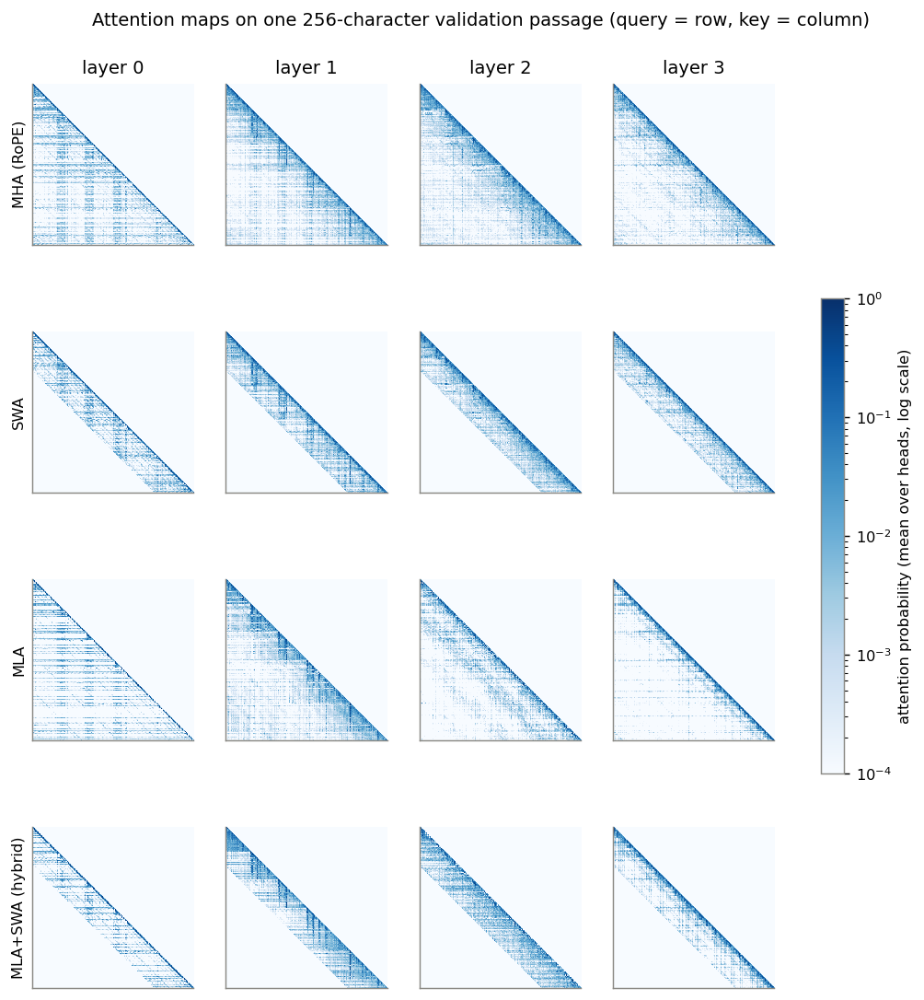

*Figure 1. Average attention of each layer on one passage of text (query on the rows, key on the columns).*

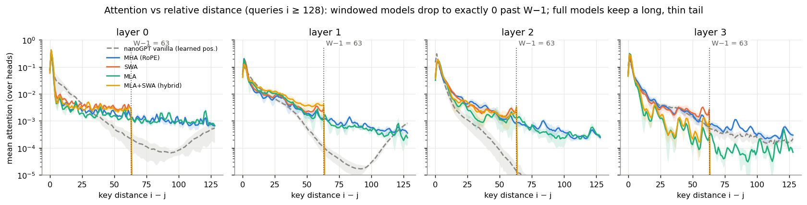

*Figure 2. Attention as a function of how far back the key is.*

I wanted the code to be usable and not only illustrative, so I also paid attention to speed. Generation uses a preallocated cache and one attention call per step, and it is reasonably fast. The weak point was the window during training, where the simple mask turned out slower than full attention, and that is why I wrote the block version. For real deployment I would still want a proper sparse kernel, and I would merge the MLA matrices into the weights once after training instead of applying them at every step.

## 3. How I compared the methods

I started from Tiny Shakespeare at character level, since it's the usual nanoGPT benchmark, and compared the validation loss. I also looked at the loss per position, to see if anything gets worse past the window.

Shakespeare doesn't really need long context, so it can't show what a window costs. For that I built a small synthetic recall task, where the model has to repeat a value it saw some distance back. It's useful because the theory says exactly where a window should stop working.

For memory and speed I measured the cache size, the time per generated token and the time per training step. These don't depend on what the model has learned, so random weights are fine, although timings on a laptop are noisy.

Finally, I looked inside the trained models, at attention maps, attention sinks, the rank of the cache and the entropy of the hidden states. I did this to understand the numbers above, and as a further check on the code.

The model has 4 layers, 4 heads, hidden size 192 and a context of 256 characters, about 1.7M parameters ([config](config/shakespeare_hybrid.py)). The window is `W = 64`. I trained each variant for 3,000 iterations with 3 seeds.

| variant | validation loss (mean ± std) | difference from MHA |
|---|---|---|
| nanoGPT (learned positions) | 1.5257 ± 0.0120 | +0.064 |
| MHA with RoPE | **1.4623 ± 0.0021** | |
| SWA | 1.4650 ± 0.0032 | +0.003 |
| MLA | 1.4741 ± 0.0153 | +0.012 |
| Hybrid | 1.4687 ± 0.0055 | +0.006 |

## 4. What the papers claim and what I found

| claim | what I found | does it hold? |
|---|---|---|
| **SWA:** the cache stops growing at `W` tokens | it stays flat at any length | yes |
| **SWA:** stacking layers extends the reach | recall works up to the predicted distance, then fails | yes |
| **SWA:** no loss of quality | almost no loss on Shakespeare | yes, on this data |
| **SWA:** faster, with custom kernels | slower with a mask, up to 3× faster with blocks | yes, with the block version |
| **MLA:** much smaller cache | 4.8× smaller here | yes |
| **MLA:** quality at least as good as MHA | slightly worse, within seed noise | can't tell |
| **MLA:** absorption makes generation efficient | correct, but slower than MHA here | not visible at this scale |
| **Hybrid:** the savings multiply | about 4,900× smaller cache at 64K tokens | yes |
| **Hybrid:** same quality and reach as SWA | quality close to MHA, shorter reach in one test | partly |

### SWA

The memory part is easy to verify: the cache stops growing at `W` tokens and its size matches the formula (Figure 8).

For the reach I used the recall task. With 4 layers and window `W`, information should be able to travel back about `4(W−1)` tokens, moving a bit further at each layer. That is what I see: with `W = 16` the model is perfect up to distance 56 and then falls to chance, close to the predicted limit of 60 (Figure 3). I only tested one fact at a time, so I can't say how much information can be passed along in this way.

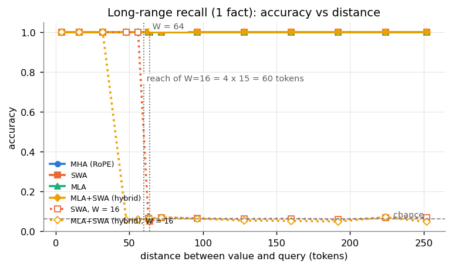

*Figure 3. Accuracy on the recall task against distance. Chance is 1/16.*

On Shakespeare the window costs almost nothing, and the loss doesn't get worse after position 64 (Figure 4). The full-attention models explain why: only about 5% of their attention goes further back than 64 characters. I wouldn't generalise this to text that really needs long context.

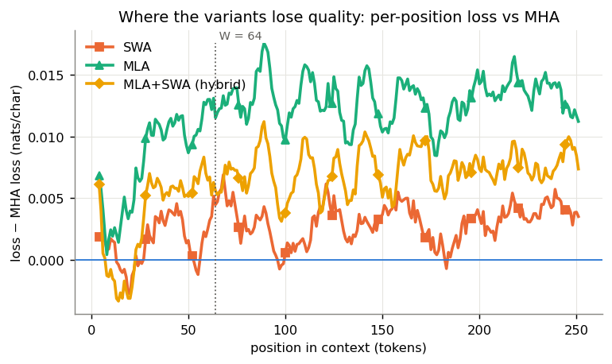

*Figure 4. Extra loss compared with MHA at each position.*

Training speed is where the implementation matters most:

| ms per training step | `T = 256` | 1K | 4K | 8K |
|---|---|---|---|---|
| MHA | 19 | 60 | 509 | 1,700 |
| SWA, mask | 17 | 74 | 812 | 3,243 |
| SWA, blocks | 21 | 60 | 272 | 556 |
| Hybrid, mask | 32 | 81 | 855 | 3,502 |
| Hybrid, blocks | 33 | 72 | 286 | 597 |

The mask gets slower than full attention as the context grows, because it still computes every score. The block version is about 2× faster than full attention at 4K and 3× at 8K, and it only starts to help from about 2K tokens. Mistral report 2× at 16K with a much bigger window and their own kernels, so this isn't the same experiment, but it goes in the same direction.

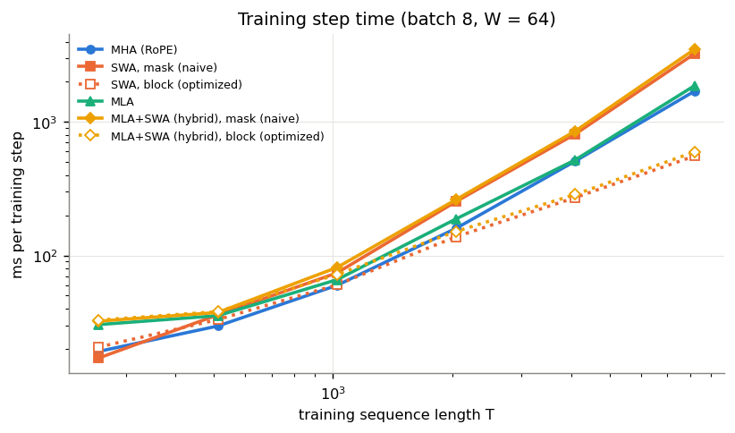

*Figure 5. Time per training step. Dotted lines are the block version.*

### MLA

MLA stores 80 numbers per token and layer instead of 384. At DeepSeek-V2's dimensions the reduction would be 57×.

What I wanted to understand is why such a strong compression loses so little. So I measured the effective rank of what standard attention caches, which is roughly how many directions really carry information. Out of 384 dimensions it is at most about 36, so a 64-dimensional vector is enough to hold it (Figure 6).

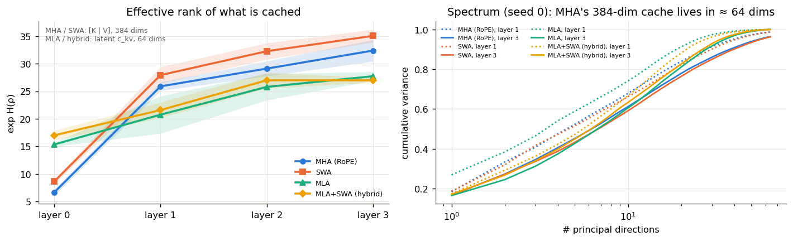

*Figure 6. Effective rank of what each variant caches, and the variance explained by the first directions.*

On quality I can't say much. MLA is slightly worse than MHA, but the difference between its own seeds is larger than that.

Absorption gives exactly the same output as the full computation, but I don't see a speed advantage: MLA is about 5 ms per token slower than MHA (Figure 7). I think that on a model this small most of the time goes into launching small GPU operations, and MLA has more of them. The gain in the paper probably needs a model big enough for memory to be the bottleneck.

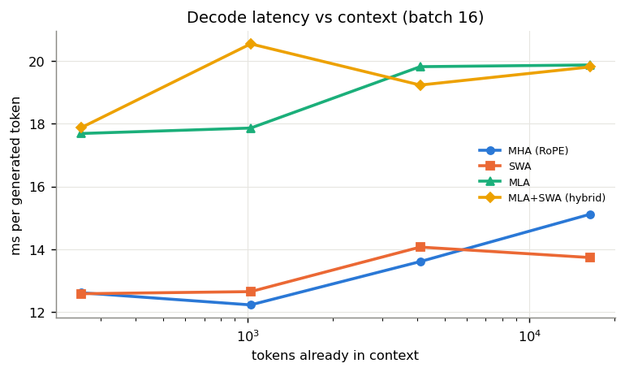

*Figure 7. Time per generated token against context length.*

### The hybrid

The savings multiply, since one method reduces the number of tokens and the other what is stored for each token. The cache is 40 KiB at any length, about 4,900× less than MHA at 64K tokens (Figure 8), and the quality stays close to MHA.

The hybrid sees the same tokens as SWA, and its generation cost also doesn't grow with the length of the text. It is about 40% slower than SWA per generated token, because each cached token needs more operations.

The reach is where it does worse. With `W = 16` it could pass a fact back only 32 tokens, while SWA reached 56. This is one seed, so I take it as a hint. My guess is that having to go through the compressed vector makes each step harder.

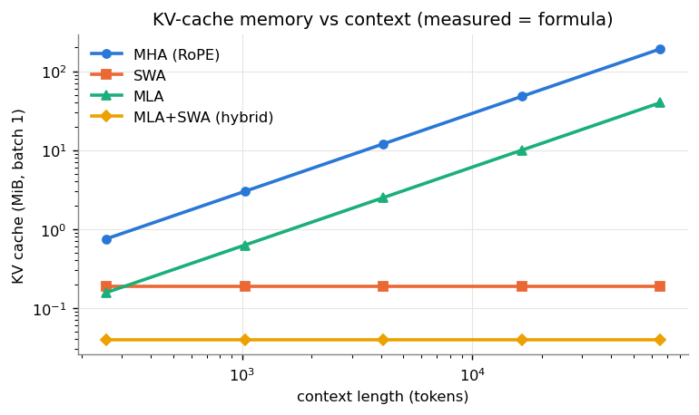

*Figure 8. Measured cache size against context length.*

## 5. Advantages and disadvantages

| method | advantages | disadvantages |
|---|---|---|
| **MHA** | Simple, best loss here, can look arbitrarily far back. | Largest cache, and it grows with the text. |
| **SWA** | Cache and generation cost depend only on `W`. No new parameters. | Can't use anything beyond its reach. `W` has to be chosen together with the depth. A ring buffer makes things like beam search harder. |
| **MLA** | Much smaller cache, fewer parameters. | Saves memory, not operations, so it can be slower. More hyperparameters. Needs retraining, so it can't be applied to an existing model. |
| **Hybrid** | Smallest cache, constant in length. | Inherits the window's limit, possibly with a shorter reach. Most hyperparameters and the highest peak memory. |

For the window itself, the mask is a few lines and is fine for short contexts, while the block version is more code but scales much better.

I would use the hybrid for serving long contexts when the cache is what limits the batch size or the context length. If a task needs exact recall of distant information, I would mix in a few full-attention layers rather than windowing every layer.

## 6. What the models learn

**Attention sinks.** Large models tend to dump attention on the first token, and this is what makes windowing risky for them ([StreamingLLM](https://arxiv.org/abs/2309.17453)). I looked for this and didn't find it: in the RoPE models the first token gets about what uniform attention would give it. That makes sense, since my sequences are random crops and the first token is never special.

What I found instead, in 14 of the 15 runs, is a head in layer 1 that puts between half and three quarters of its attention on newline characters. The value vectors of those newlines are small, so the head looks at them but reads very little, which is how sinks behave. It follows the most recent line starts (Figure 9), and it is strongest in MLA and in the hybrid (Figure 10).

For SWA this works because Shakespeare's lines are shorter than the window, so there is always a newline in view. I suspect it would be a problem with long paragraphs, but I didn't test that.

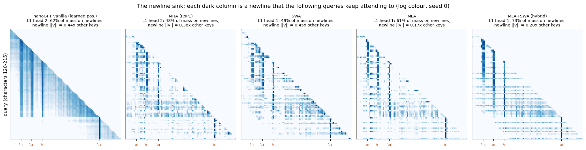

*Figure 9. The newline head of each model on 96 characters. Each dark column is a newline.*

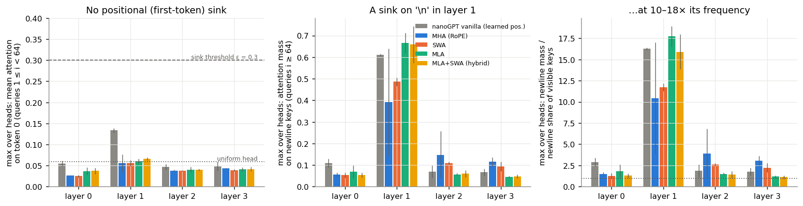

*Figure 10. Attention on the first token (left) and on newlines (centre and right), averaged over seeds.*

**Hidden representations.** I also measured the entropy of the hidden states at each layer, shown in Figure 11 as an effective rank. The four RoPE models look almost the same, so changing the attention doesn't seem to change much here. The only different one is the original nanoGPT, where learned positions make the first token clearly larger in norm.

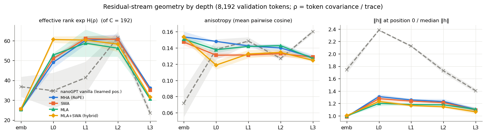

*Figure 11. Geometry of the hidden representations at each depth.*

## 7. Limitations and next steps

This is a small model on a small dataset, so the numbers at paper scale are only formulas, and Shakespeare doesn't need long context. Next I would try recall with several facts, and sweeps over `W` and `d_c`. I would also add more seeds, because with three I can't separate MLA from the hybrid, and the hybrid's reach result comes from a single seed.
